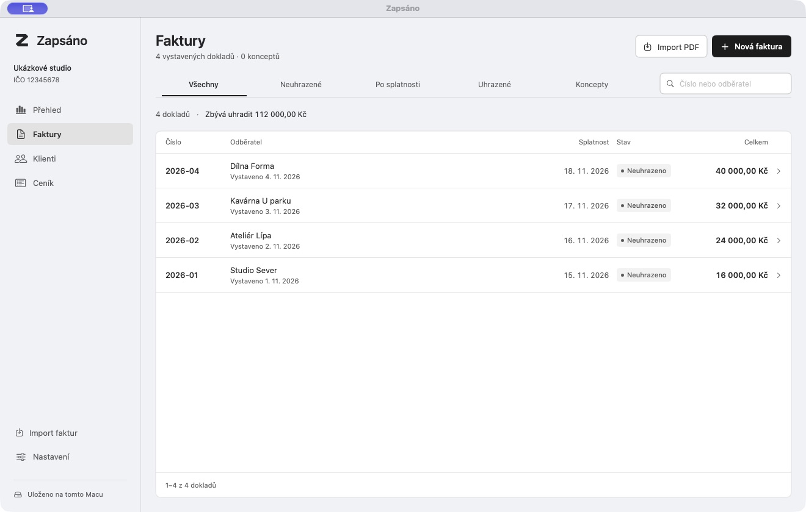
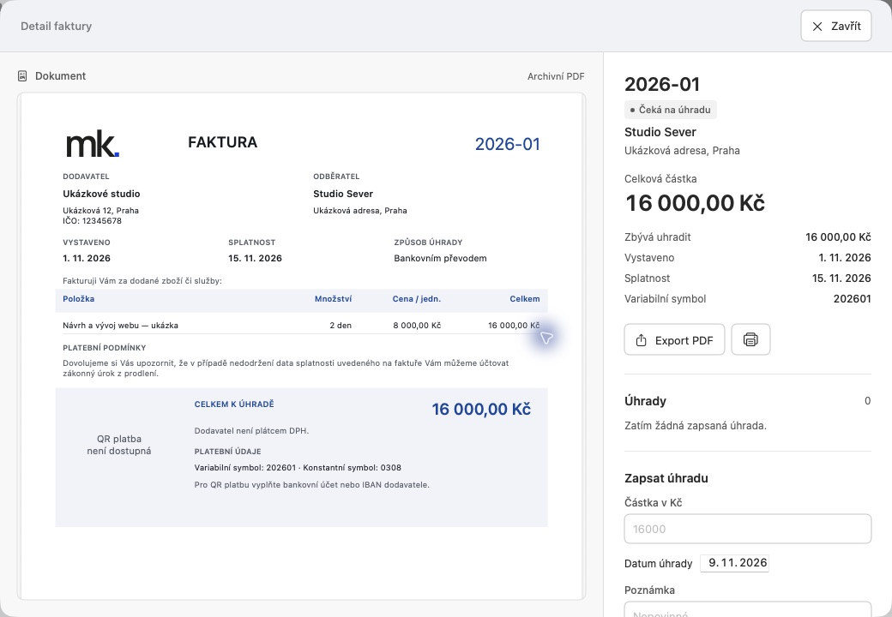

# Zapsáno

**Vystavit. Odeslat. Zapsáno.**

Nativní fakturace pro Mac, zaměřená na české neplátce DPH. Klienti, ceník, faktury v korunách, PDF s QR platbou a evidence úhrad v jedné lokální aplikaci.



> Projekt je ve vývoji. Před použitím s vlastními doklady ověřte údaje a vzorové PDF a vytvořte zálohu. Screenshoty obsahují pouze ukázková data.

## Co umí

- Klienti, ceník služeb a zboží, koncepty a vlastní číselná řada.
- Faktury s desetinným množstvím, slevou, splatností a variabilním symbolem.
- Náhled, export a tisk českého PDF; lokální generování platebního QR kódu.
- Evidence částečných úhrad a filtry neuhrazených faktur a dokladů po splatnosti.
- Duplikace a úpravy vlastních faktur s bezpečnostní zálohou.
- Doplnění údajů firmy z veřejného ARES podle IČO na vyžádání.
- Záloha a obnova včetně PDF, import podporovaných textových PDF.

Rozsah je **jedna firma, neplátce DPH, CZK**. Nejde o kompletní účetnictví ani daňové přiznání. Aplikace neodesílá faktury e-mailem a neprovádí bankovní platby; exportované PDF odešlete vlastním způsobem.

## Spuštění ze zdrojů

Potřebujete **macOS 15+**, **Swift 6.0+** a Xcode nebo Command Line Tools s odpovídajícím SDK. Projekt používá Apple frameworky a místní balíček `FakturaCore`, bez vzdálených Swift balíčků.

Po klonování otevřete složku repozitáře v terminálu:

```sh
swift build
swift run Faktura
```

Nebo otevřete `Faktura.xcodeproj`, vyberte schéma **Faktura** a cíl **My Mac**. Technický název targetu, bundle ID a datová složka zůstávají `Faktura` kvůli návaznosti dat; aplikace se jmenuje **Zapsáno**.

### Vlastní .app

```sh
zsh scripts/build-app.sh
open build/Zapsáno.app
```

Výstupem je lokálně podepsaná aplikace pro architekturu aktuálního Macu. Skript neprovádí Developer ID podepsání ani notarizaci.

## Kde začít s úpravami

| Cesta | Účel |
| --- | --- |
| `Faktura/App/` | Vstupní bod a hlavní rozhraní |
| `Faktura/Features/` | Faktury, klienti, nastavení a další obrazovky |
| `Faktura/Persistence/` | SwiftData úložiště, zálohy a obnova |
| `Faktura/Documents/` | PDF a související dokumenty |
| `Faktura/Services/` | Integrace a pomocné služby |
| `Packages/FakturaCore/` | Pravidla faktur, plateb a výpočtů |
| `Tests/FakturaAppTests/` | Testy aplikace, importu, úložiště a PDF |
| `Branding/` | Ikona aplikace |

Při úpravách zachovejte přesné desetinné výpočty, číslování faktur a ochranu existujících dokladů. Importované doklady se nepřepisují jako vlastní faktury.

```sh
swift test
swift test --package-path Packages/FakturaCore
```

Volitelný původní experiment s úložištěm má vlastní testy:

```sh
swift test --package-path Prototypes/PersistenceProbe
```

Pro izolované testy použijte `AppStore(directory:)` s dočasnou složkou, stejně jako existující testy. Běžné spuštění používá osobní úložiště; aplikace aktuálně nemá přepínač `--demo`.

## Data a zálohy

Data se ukládají do `~/Library/Application Support/Faktura/`. V **Nastavení → Exportovat zálohu** vytvoříte JSON zálohu s doklady, klienty, úhradami a PDF včetně kontrolních součtů. Zálohy nejsou šifrované.

Před úpravami, smazáním a obnovou vznikají bezpečnostní kopie. Po obnově potvrďte další číslo faktury podle posledního skutečně vydaného dokladu. Nekopírujte pouze otevřený SQLite/SwiftData soubor jako jedinou zálohu.

## Omezení

- Bez DPH, přijatých faktur, evidence nákladů, zálohových a opravných dokladů.
- Import podporuje ověřené jednostránkové textové PDF iDokladu pro neplátce DPH; nejde o univerzální OCR.
- Metadata se zatím načítají jako jeden verzovaný záznam; pro velké objemy je potřeba další optimalizace.
- PDF šablona obsahuje výchozí logo autora. Pro vlastní použití upravte `Faktura/Resources/SupplierLogo.pdf` a příslušnou šablonu.

## Příspěvky

Forkněte projekt, změnu připravte v samostatné větvi a přidejte testy pro dotčená pravidla. U změn datového formátu popište migraci a kompatibilitu záloh. Do issue ani pull requestů nepřikládejte skutečné faktury, bankovní údaje nebo zálohy klientů.

## Další náhled



## Licence a použité prostředky

Zdrojový kód: [MIT](LICENSE) © 2026 Matěj Kratochvíl.

Oznámení k písmu Manrope zůstává v [`Manrope-OFL.txt`](Faktura/Resources/Manrope-OFL.txt); původ vloženého loga a podmínky použitých prostředků popisuje [`SupplierLogo-Provenance.txt`](Faktura/Resources/SupplierLogo-Provenance.txt). MIT nepřepisuje licence třetích stran.
